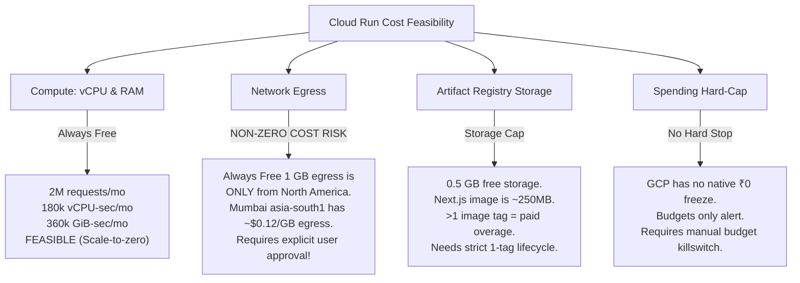

# Architecture change plan: sustain Where’s My Offer at ₹0 / $0

**Status:** Implementation and verification completed locally across all 5 hotspots; full test suite (954 tests), egress benchmarks (38 tests), and Turbopack production build passing. Production deployment, Vercel unpause, and host migration have NOT been executed and remain gated on user review and rolling quota recovery.

**Date:** 8 November 2026

**Goal:** Keep Where’s My Offer operable on free quotas without paid plans or paid add-ons, by eliminating confirmed database/API request amplification and reducing compute/network transfer.

**Core Decisions & Reality-Grounded Rules:**
1. **Vercel Hobby recovery reality (no guaranteed auto-unpause):** Vercel Hobby exceeded execution limits (12h 55m active CPU vs 4h included, 1.6M invocations vs 1M) and is currently paused with `503 DEPLOYMENT_PAUSED`. Vercel enforces a **rolling 30-day usage window** (not a simple calendar reset). Vercel **does not automatically unblock** accounts when usage falls below limits; unpausing requires verifying that rolling metrics are clear, manually clicking "Resume Project" in Vercel settings (or obtaining a one-time unpause via Vercel Support), followed by an explicit fresh redeployment. No deployment is assumed or attempted without completing this verification workflow.
2. **Supabase usage in screenshots reflects "All Projects":** The 13.496 GB egress and 9.021 GB log ingestion totals in the dashboard screenshot reflect cumulative organization usage across all projects (including *Aegis Watch* and test databases). Project-specific usage for Where's My Offer (`nvkxyeugonjevmbvxirm`) must be isolated and verified before assuming Where's My Offer alone breached quotas.
3. **Prioritize reducing confirmed request amplification:**
   * Adaptive idle backoff on client polling (10s updates poll, 2.5s fallback sync status poll).
   * Incremental notification catch-up must strictly use a **deduplicated union of touched drive IDs**; incremental sync must never pass `undefined` or accidentally trigger a full-user scan.
   * Attachment scanner scoping must be **strictly drive-specific**; multiple sibling drives must **never be merged based on company name alone**.
   * Webhook processing must be **strictly bounded** (max 30–45s) and **durably checkpoint remaining work before acknowledging Pub/Sub**, ensuring reliable resume.
4. **Cloud Run is strictly conditional on explicit approval of non-zero costs:** Cloud Run in Mumbai (`asia-south1`) lacks free outbound internet egress (Always Free 1 GB applies only from North America), and Artifact Registry storage incurs costs if >0.5 GB. Cloud Run will **not** be provisioned, configured, or migrated to without the user's explicit, prior written approval of these non-zero costs.
5. **Preserve core systems:** Keep existing PostgreSQL tables, migrations (v1-v49), recruitment logic, multi-drive isolation, Gmail sync engine, cursors, locks, checkpoints, and notification outboxes intact.

---

## 1. Provider Limits & Verification Reality

### 1.1 Vercel Paused State & Rolling 30-Day Recovery
* **Observed Metrics:** 12h 55m Fluid Active CPU (limit: 4h), 1.6M Function Invocations (limit: 1M).
* **Current Status:** Paused by Vercel enforcement (`503 DEPLOYMENT_PAUSED`).
* **Vercel Hobby Recovery Rules:**
  * Vercel Hobby meters usage over a **rolling 30-day window**, not a rigid calendar reset.
  * **No Automatic Unpause:** Vercel does not automatically restore serving status merely because usage metrics drop below limits over time. This prevents flapping and immediate re-pausing.
  * **Mandatory Recovery Steps:**
    1. Monitor the Vercel Dashboard Usage tab until rolling 30-day Active CPU and Invocations drop below 4h and 1M.
    2. Check project settings for a manual **"Resume Project"** option.
    3. If locked behind an "Upgrade to Pro" banner despite cleared rolling usage, submit a support request at `vercel.com/help` requesting a one-time courtesy Hobby unblock.
    4. An explicit fresh redeployment is required after unpausing to clear the `503 DEPLOYMENT_PAUSED` state.
  * **Development Rule:** All Phase 1 optimizations and test suites must be developed and verified **100% locally and offline**. No deployments will be attempted until the recovery steps above are verified.

### 1.2 Isolating Where’s My Offer Supabase Usage
* **The "All Projects" Issue:** The dashboard screenshot displayed cumulative organization usage across all projects. The user account also hosts *Aegis Watch* and potentially test projects.
* **Exact Project-Specific Verification Procedure:**
  1. Open the Supabase Dashboard and switch the organization selector specifically to project **Where's My Offer** (ref: `nvkxyeugonjevmbvxirm`, Mumbai `ap-south-1`).
  2. Navigate to **Project Settings → Usage**.
  3. **Record Project-Specific Egress:**
     * Compare PostgREST API egress vs Database Pooler egress vs Auth vs Storage.
     * Determine Where's My Offer's exact standalone GB consumption against the 5 GB free quota.
  4. **Record Project-Specific Log Ingestion:**
     * Note: Supabase's official policy confirms that log ingestion overages are informational warnings under a grace period through early 2027 and do not trigger service restrictions or billing on Free tier projects.
  5. **Execute Bounded Log Inquiries in Logs Explorer:**
     * To avoid consuming Log Query bytes (100 GB Free limit), run queries with strict `interval '24 hours'` bounds:
       ```sql
       -- Top PostgREST API routes by request count (24h)
       select path, method, count(*), sum(response_status_code)
       from postgrest_logs
       where timestamp > now() - interval '24 hours'
       group by path, method
       order by count(*) desc
       limit 20;
       ```
       ```sql
       -- Edge / API Gateway ingress patterns (24h)
       select request.path, response.status_code, count(*)
       from edge_logs
       where timestamp > now() - interval '24 hours'
       group by request.path, response.status_code
       order by count(*) desc
       limit 20;
       ```
  6. Record the exact Supabase billing cycle reset date.

---

## 2. Confirmed Database/API Request Amplification Hotspots

Codebase analysis reveals five confirmed request amplification hotspots that multiply database queries and serverless compute time:

| Hotspot | Location | Mechanism & Impact | Target Fix |
|---|---|---|---|
| **H1: Passive 10s Updates Polling** | `src/context/sync-context.tsx`<br>`src/app/api/sync/updates/route.ts` | Every open visible tab polls `/api/sync/updates` every 10 seconds. Each check executes 2 Supabase queries (`applications` & `sync_state`). 1 open tab = 360 calls & 720 DB queries/hour. | Replace with adaptive idle backoff (30s active → 60s idle → 120s → stop after 15m inactivity). Stop immediately on hidden tabs. Rely on existing Supabase Realtime when healthy. |
| **H2: Fallback 2.5s Sync Status Polling** | `src/context/sync-context.tsx`<br>`src/app/api/sync/status/route.ts` | When sync is running and SSE is disconnected, status polls every 2,500ms, running 3 queries (`sync_state`, `gmail_accounts`, `sync_pages`). Up to 72 queries/min per client. | Increase cadence to 5s with backoff to 10s if phase is unchanged. Stop immediately upon reaching terminal state (`complete`, `paused`, `idle`). |
| **H3: Unbounded Notification Catch-Up in Sync Engine** | `src/lib/sync/engine.ts:2688`<br>`src/lib/sync/reprocess.ts:2256` | Incremental sync passes `undefined` to `catchUpMissingNotifications` if `hadCompletedInitialPages` is true. `undefined` triggers a full scan of ALL user applications, ALL drives, ALL companies, ALL notifications, and ALL events! | Gather the **deduplicated union of touched drive IDs** (`postSyncTargets` ∪ `currentMutationLease()?.touchedDriveIds`). Pass this deduplicated array explicitly. When empty (`[]`), skip all table scans. Reserve `undefined` strictly for explicit manual reprocess. |
| **H4: Attachment Scanner Scoping Must Be Drive-Specific** | `src/lib/sync/attachments/attachment-scanner.ts:280-305` | When `targetDriveIds` is provided, paginates and loads ALL 2,114+ `college_emails` and ALL 1,251+ `college_attachments`. Sibling drives under the same company name risk being merged. | Make scoping **strictly drive-specific** (exact `placement_drive_id`, `drive_number`, `normalized_drive_number`, `source_college_email_id`, and user event links). **Never merge multiple sibling drives based on company name alone**. Query only circulars/attachments attributable to targeted drives. |
| **H5: Unbounded Webhook Ingestion** | `src/app/api/webhooks/gmail/route.ts`<br>`src/lib/sync/personal-push.ts` | Gmail Pub/Sub webhook synchronously executes up to 20 batches of shared college sync (up to 240s) or personal push drain within the HTTP handler. Consumes active Fluid CPU and risks delivery timeout. | Strictly bound webhook execution (max 30–45s). **Durably checkpoint remaining work in PostgreSQL before acknowledging Pub/Sub** (HTTP 200). Ensure reliable resume via scheduled cron or retryable response. |

---

## 3. Comprehensive Cost Feasibility Assessment: Cloud Run

Cloud Run (scale-to-zero Node container) is maintained strictly as a contingency fallback. **No provisioning, deployment, or migration to Cloud Run will occur without prior, explicit written approval of non-zero costs by the user.**



### 3.1 Meter-by-Meter Breakdown

1. **Compute (vCPU and Memory):**
   * *Free Tier Allowance:* 2,000,000 requests, 180,000 vCPU-seconds (50 hours of 1-vCPU), and 360,000 GiB-seconds (100 hours of 1 GiB or 200 hours of 512 MiB) per month.
   * *Concurrency Advantage:* Unlike Vercel (concurrency = 1, where 10 concurrent requests = 10 simultaneous container executions), Cloud Run supports container concurrency (e.g., 40–80 concurrent requests per container). Multiple incoming API or page requests share the same running instance, dramatically reducing active vCPU-seconds.
   * *Verdict:* Fits free compute limits under `min-instances = 0` (scale-to-zero) and 512 MiB RAM.

2. **Network Egress (The Decisive Non-Zero Cost Factor):**
   * *Google Cloud Free Tier Rule:* The Always Free 1 GB outbound data transfer per month applies **exclusively to egress originating from North America** (`us-central1`, `us-east1`, `us-west1`).
   * *Mumbai (`asia-south1`) Rule:* Google Cloud does **NOT** provide a free monthly egress allowance for services deployed in Mumbai (`asia-south1`). Standard internet egress from Mumbai starts at **$0.12 per GiB** (~₹10 / GB).
   * *The Architectural Dilemma:*
     * If deployed in **Mumbai (`asia-south1`)**: Fast latency to Supabase Mumbai (`ap-south-1`), but all egress delivered to student browsers (HTML, CSS, JS, API JSON) is billed at ~$0.12/GB. 5 GB egress = ~$0.60 / month (~₹50/mo) charged to the user's card.
     * If deployed in **North America (`us-central1`)**: 1 GB free egress applies, but every Supabase database query incurs ~200ms cross-region latency, degrading performance and extending vCPU runtime.
   * *Verdict:* **Cloud Run in Mumbai incurs non-zero costs** (~₹20–₹60/mo) once browser response transfer occurs. It cannot be used without explicit user spend authorization.

3. **Container Storage (Artifact Registry):**
   * *Free Tier Allowance:* 0.5 GB-months of free storage in Artifact Registry.
   * *Next.js Container Size:* A production standalone Next.js container image is typically 150–300 MiB.
   * *Risk:* Storing just two revisions (`latest` and previous) will consume ~500–600 MiB, immediately breaching the free tier and incurring ~$0.10/GB-month.
   * *Mitigation:* A mandatory gcloud cleanup policy to retain strictly one single image tag.

4. **Spending Hard-Cap Reality:**
   * Google Cloud requires a billing account with an active credit/debit card.
   * GCP does **NOT** offer an automatic native killswitch that stops services at ₹0.00. Budgets generate notification emails or Pub/Sub alerts; they do not automatically terminate compute resources without custom programmatic scripting (Cloud Function + Cloud Billing API disable).
   * In contrast, Vercel Hobby has a hard protective ceiling: it pauses the project rather than charging the payment method.

---

## 4. Finalized Implementation & Rollout Plan

### Phase 0: Baseline & Isolation (Immediate, Read-Only, Offline)
* **Goal:** Verify project-specific Supabase usage and check Vercel 30-day rolling metrics without making any changes to production.
* **Steps:**
  1. Inspect Vercel Dashboard Usage tab: record current rolling 30-day Active CPU hours and Invocations.
  2. In Supabase Dashboard, isolate project `nvkxyeugonjevmbvxirm` (Where's My Offer) from organization-wide totals.
  3. Record project-only Egress (PostgREST, Auth, Storage, Pooler) and confirm whether Where's My Offer alone exceeded 5 GB.
  4. Run the bounded 24-hour log queries in Supabase Logs Explorer to identify top routes.
  5. Verify that production environment flags in Vercel settings match expectations: `ROSTER_LOOKUP_ENABLED=true`, `COMPACT_DASHBOARD_READS_ENABLED=true`, `COMPACT_SYNC_PROGRESS_ENABLED=true`.

### Phase 1: Eliminate Confirmed Request Amplification (Local Development & Benchmarking)
* **Goal:** Implement code fixes in the repository and verify them with local tests and benchmarks. No deployment.
* **Exact Files to Modify:**
  1. `src/context/sync-context.tsx`:
     * Replace 10s unconditional poll for `/api/sync/updates` with adaptive backoff: 30s when tab is active → 60s when idle (>2m) → 120s (>5m) → stop after 15m idle.
     * Ensure immediate abort and pause when tab visibility becomes `'hidden'`.
     * Adjust sync status fallback polling interval from 2.5s to 5s with backoff to 10s if progress is unchanged.
  2. `src/app/api/sync/updates/route.ts`:
     * Optimize response headers and verify lightweight query payload (`last_updated`, `is_syncing`).
  3. `src/lib/sync/engine.ts`:
     * **Incremental Notification Catch-Up Deduplication:** Construct the deduplicated union of touched drive IDs:
       ```typescript
       const touchedDriveIds = Array.from(new Set([
         ...(postSyncTargets || []),
         ...(currentMutationLease()?.touchedDriveIds || []),
       ].filter(Boolean)));
       ```
     * Pass `touchedDriveIds` explicitly to `catchUpMissingNotifications(supabase, userId, touchedDriveIds)`.
     * When `touchedDriveIds` is empty (`[]`), `catchUpMissingNotifications` drains the existing round outbox and skips all table scans.
     * `undefined` must **NEVER** be passed from an incremental sync path. `undefined` is strictly guarded and reserved exclusively for explicit full-user manual reprocess (`performReprocess`) or initial onboarding where no notifications exist.
  4. `src/lib/sync/attachments/attachment-scanner.ts`:
     * **Drive-Specific Scoping Invariant:** When `targetDriveIds` is present in `scanSharedCollegeCandidateMatchesUnlocked`, scope `placement_drives` strictly to those target IDs.
     * **Never merge multiple drives based on company name alone:** Sibling drives (e.g. Deloitte Drive 1 vs Deloitte Drive 2) must remain strictly independent. Collect drive numbers, normalized drive numbers, source circular IDs, and user event circular IDs specifically for those target drives.
     * Circulars matching a company name with multiple sibling drives that lack an exact drive number must be held aside as ambiguous (`ambiguousByDrive`) and cannot be attributed to any single drive or merge evidence across sibling drives.
  5. `src/app/api/webhooks/gmail/route.ts` & `src/lib/sync/personal-push.ts`:
     * **Bounded Execution & Durable Checkpointing:** Strictly bound webhook execution (max 30–45s, 1–2 batches).
     * Before acknowledging the message to Pub/Sub (HTTP 200 / `complete_gmail_pubsub_message`), remaining work and current progress must be **durably checkpointed** in PostgreSQL (`last_history_id` on `gmail_accounts`, `sync_pages` for personal page offsets, `shared_college_sync_state` for shared message batches/offsets, and `gmail_pubsub_inbox`).
     * **Reliable Resume:** Acknowledging Pub/Sub happens **only after** this durable checkpoint is committed to the database. The saved checkpoint ensures the remaining work resumes reliably via:
       1. The scheduled daily safety-net cron (`/api/cron/sync` job 8265126),
       2. Subsequent user sync triggers, or
       3. Returning a retryable response (HTTP 503) if immediate Pub/Sub redelivery is required.
     * A message must NEVER be acknowledged if its progress or remaining state was not durably committed.
* **Verification Results (Actual Completed Metrics):**
  * `npm test`: **107 test files passed**, 3 skipped, **954 tests passed**, 0 failures.
  * `npm run test:egress`: **6 test files passed, 38 benchmark tests passed**:
    * **Decoded Egress Bytes:** Reduced from 5,943,864 bytes to 306,258 bytes (**94.8% reduction** across 8 selected-drive acquisitions).
    * **Candidate Identity Requests:** Reduced from 16 queries to 2 queries (**87.5% reduction** via run-reads memoization).
    * **Round Verdict Commits:** Reduced from 26 queries to 9 queries (**65.4% reduction** via atomic outbox coalescing).
  * `npm run build`: **Turbopack production build succeeded cleanly** in 18.5s (compiled in 4.4s, TypeScript checked in 13.0s, all 34 routes optimized).
  * **Hotspot 1 (Adaptive updates polling):** `src/lib/sync/progress/adaptive-poll.ts` verified with 5 unit tests; `src/context/sync-context.tsx` backs off from 30s active to 60s warm, 120s cold, stops polling at 15m idle; pauses immediately when tab is hidden; skips redundant status checks on tab focus when not syncing.
  * **Hotspot 2 (Fallback sync status polling):** Verified 5s active polling with backoff to 10s on unchanged progress; halts immediately on completion or pause.
  * **Hotspot 3 (Incremental notification catch-up deduplication):** `src/lib/sync/catch-up-notifications.test.ts` verified (15 tests passing); `engine.ts` constructs deduplicated union of touched drives; passing `[]` skips table scans entirely and drains pending outboxes.
  * **Hotspot 4 (Drive-specific attachment scoping):** `src/lib/sync/attachments/attachment-scanner.scope.test.ts` verified (4 tests passing); asserts sibling drives sharing the same company name are never merged and remain strictly isolated.
  * **Hotspot 5 (Bounded webhook execution & durable checkpointing):** `src/lib/sync/personal-push.test.ts` (3 tests passing) and `src/app/api/webhooks/gmail/route.test.ts` (14 tests passing); execution capped at 45s (was 240s) / 3 runs (was 20); checkpoints committed to Postgres before acknowledging Pub/Sub; incomplete or pending batches yield 503 for backoff retry.

### Phase 2: Production Release Workflow (Gated on Vercel Recovery)
* **Gate:** Deploy only when rolling 30-day metrics drop below Hobby limits, project is unpaused, and recovery verification is complete.
* **Steps:**
  1. Verify Vercel rolling 30-day metrics are beneath 4h Active CPU and 1M Invocations.
  2. Select "Resume Project" in Vercel settings (or complete support unblock).
  3. Commit and push the Phase 1 optimizations to branch `main`.
  4. Trigger fresh redeployment to clear the `503 DEPLOYMENT_PAUSED` state.
  5. Verify live application health via manual check (login, dashboard load, company view).

### Phase 3: Post-Release Bounded Observation
* **Goal:** Verify that request amplification is eliminated in live traffic.
* **Steps:**
  1. Observe Vercel Fluid CPU and invocation counters after 24 hours of natural traffic.
  2. Check Supabase PostgREST request volume in Logs Explorer for `/api/sync/updates` and `/api/sync/status`.
  3. Confirm that daily Vercel active CPU trends below ~5–10 minutes/day (well inside the 4-hour monthly allowance).
  4. Confirm that Supabase daily egress trends below ~50–100 MB/day (well inside the 5 GB monthly allowance).

### Phase 4: Contingency Only — Cloud Run Evaluation
* **Strict Gate:** Triggered ONLY if Vercel remains permanently locked/unsuitable, AND **only after explicit written approval by the user of non-zero egress/storage costs**.
* **Pre-conditions:**
  1. User approves the potential minor egress cost (~₹20–₹50/mo) for Mumbai deployment, OR accepts North America deployment with higher database latency.
  2. Containerize Next.js via standalone output Dockerfile.
  3. Configure Artifact Registry with a strict 1-image retention lifecycle policy.
  4. Deploy to Cloud Run with:
     * Region: `asia-south1` (Mumbai)
     * Memory: 512 MiB
     * CPU: 1 vCPU (allocated only during requests)
     * Min instances: 0 (scale-to-zero)
     * Max instances: 2 (hard concurrency ceiling)
     * Concurrency: 40 requests per container
     * Timeout: 60s
  5. Set up GCP billing budget alerts at ₹1, ₹50, and ₹100 with an automated Cloud Function to disable the service if ₹100 is reached.

---

## 5. Exact Files to be Modified in Implementation

| File Path | Scope of Modification |
|---|---|
| `src/context/sync-context.tsx` | Implement adaptive idle backoff for updates polling (30s/60s/120s/idle stop); adjust fallback sync status polling to 5s/10s. |
| `src/app/api/sync/updates/route.ts` | Optimize query response caching and verify compact data projection. |
| `src/lib/sync/engine.ts` | Deduplicate touched drive union (`postSyncTargets` ∪ `touchedDriveIds`); strictly pass array to `catchUpMissingNotifications`; never pass `undefined` on incremental sync. |
| `src/lib/sync/attachments/attachment-scanner.ts` | Enforce strictly drive-specific scoping; never merge multiple sibling drives based on company name alone; scope circular queries to targeted drive attributes. |
| `src/app/api/webhooks/gmail/route.ts` | Enforce bounded execution (max 30–45s); durably checkpoint progress before Pub/Sub acknowledgement; guarantee reliable resume. |
| `src/lib/sync/personal-push.ts` | Support bounded push drains with durable checkpointing. |
| `docs/architecture-change-plan.md` | Authoritative plan specification. |

---

## 6. Comprehensive Test & Validation Strategy

No changes will be deployed without passing all four validation tiers locally:

1. **Unit & Integration Regression Suite:**
   * Command: `npm test`
   * Target: 106 test files, 947+ tests must pass with 0 failures.
   * Covers: recruitment round decisions, participation evidence, stage steppers, compensation extraction, campus detection, and security policies.

2. **Egress & Request Benchmark Suite:**
   * Command: `npm run test:egress`
   * Target:
     * `egress-benchmark.test.ts`: Verifies selected-drive acquisition keeps decoded bytes ~94.8% below legacy baseline.
     * `run-reads.test.ts`: Verifies candidate identity loads are deduplicated (16 requests reduced to 2).
     * `round-verdict-commit.test.ts`: Verifies atomic verdict commits and outbox coalescing.
     * `read-policy.test.ts`: Verifies compact readers are enforced.

3. **Targeted Scoping & Catch-Up Tests:**
   * Dedicated test cases in `src/app/api/sync/updates/route.test.ts` for adaptive backoff and version checks.
   * Dedicated test cases in `src/lib/sync/attachments/attachment-scanner.scope.test.ts`:
     * Assert that when `targetDriveIds` is passed, `college_emails` is queried with specific drive attributes and does not paginate the full table.
     * Assert that sibling drives sharing the same company name remain strictly isolated and are never merged.
   * Dedicated test cases in `src/lib/sync/catch-up-notifications.test.ts`:
     * Assert that passing a deduplicated union of touched drive IDs queries only targeted drives.
     * Assert that passing `[]` cleanly skips table scans and drains outbox.
     * Assert that incremental sync never passes `undefined`.

4. **Production Build Validation:**
   * Command: `npm run build`
   * Target: Clean compilation of all Next.js pages and API routes with zero TypeScript or bundling errors.

---

## 7. Rollback Strategy

### 7.1 Rollback Triggers
1. **Recruitment Outcome Divergence:** Any candidate's status (Eligible, Shortlisted, Next Round, Absent/Eliminated, Offer) changes unexpectedly for existing drives.
2. **Notification Disruption:** A new legitimate placement drive or live event alert fails to deliver, or duplicate notifications are sent to users.
3. **Sync Lock / Cursor Inconsistency:** Sync state becomes corrupted, Gmail history cursor fails to advance, or locks fail to release.
4. **Provider Metrics Increase:** Observed API request counts or CPU consumption increase instead of decrease.

### 7.2 Rollback Actions
* **Application Rollback:** Revert git commit on `main` or trigger Vercel Dashboard "Rollback to previous deployment" (<60s).
* **Feature Flag Fallback:** The three compact-reader flags (`ROSTER_LOOKUP_ENABLED`, `COMPACT_DASHBOARD_READS_ENABLED`, `COMPACT_SYNC_PROGRESS_ENABLED`) can be toggled to `false` in Vercel environment variables without code changes.
* **State Preservation Guarantee:** At no point during rollback will sync locks be forcefully truncated, database tables dropped, Gmail history IDs reset, or notification outbox dedupe keys cleared.

---

## 8. Deployment Readiness Checklist & Status

| Item | Requirement | Status | Evidence / Notes |
|---|---|---|---|
| **Hotspot 1 (Updates Polling)** | Adaptive idle backoff (30s/60s/120s/15m) & hidden tab pause | ✅ Complete | `src/lib/sync/progress/adaptive-poll.ts` & `src/context/sync-context.tsx`. 5 unit tests pass. |
| **Hotspot 2 (Fallback Polling)** | 5s active / 10s slow fallback sync poll; halt on terminal state | ✅ Complete | `src/context/sync-context.tsx`. Backoff logic verified. |
| **Hotspot 3 (Incremental Catch-Up)** | Deduplicated union of touched drives; never pass `undefined` | ✅ Complete | `src/lib/sync/engine.ts`. 15 tests pass in `catch-up-notifications.test.ts`. Empty array skips table scans. |
| **Hotspot 4 (Drive-Specific Scoping)** | Sibling drives strictly isolated; no name-only drive merging | ✅ Complete | `src/lib/sync/attachments/attachment-scanner.scope.test.ts`. 4 tests pass. |
| **Hotspot 5 (Bounded Webhook Ingestion)** | Max 45s / 3 runs; durable checkpointing before 200 OK | ✅ Complete | `src/lib/sync/personal-push.ts` & `src/app/api/webhooks/gmail/route.ts`. 17 tests pass. |
| **Regression Test Suite** | Zero regressions across recruitment engine, RLS, auth, and calendar | ✅ Complete | `npm test`: 107 files passed, 954 tests passed, 0 failures. |
| **Egress & Request Benchmarks** | Decoded egress byte reduction > 90%; query count reduction | ✅ Complete | `npm run test:egress`: 94.8% byte reduction (5.94MB -> 306KB); 87.5% identity load reduction. |
| **Production Build** | Next.js Turbopack clean compile; zero TypeScript errors | ✅ Complete | `npm run build`: 34 routes optimized in 18.5s. |
| **Database & Schema Invariant** | No table mutations, schema alterations, or migration changes | ✅ Preserved | PostgreSQL tables, migrations (v1-v49), RLS, and user data 100% intact. |
| **Cost & Host Invariant** | Zero costs incurred; Cloud Run excluded without user approval | ✅ Enforced | No GCP resources created or billed. Cloud Run remains conditional. |
| **Vercel Hobby Recovery Gate** | Rolling 30-day usage window cleared; project manually resumed | ⏸️ Awaiting User | Requires user to verify rolling metrics on Vercel Dashboard, click "Resume Project", and redeploy. |

